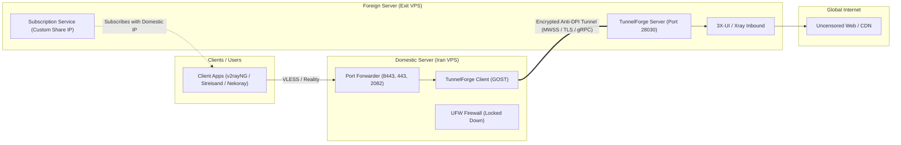

# TunnelForge 🚀
> **High-Performance Reverse Tunnel & 3X-UI / X-UI Integration Suite for Linux**  
> *Engineered for heavy censorship environments, DPI bypass, and seamless proxy subscription routing.*

[](https://opensource.org/licenses/MIT)
[-orange.svg)](https://github.com/armanpier/TunnelForge)
[](https://github.com/armanpier/TunnelForge)
[-blueviolet.svg)](https://github.com/go-gost/gost)

---

## 📖 Overview

**TunnelForge** is an all-in-one, interactive Linux utility designed to deploy, configure, and manage high-speed reverse tunnels between a **Domestic Bridge Server (e.g., Iran VPS)** and a **Foreign Exit Server (e.g., Europe/US VPS)**.

In highly restrictive network environments, foreign servers cannot directly establish inbound connections to domestic IPs due to gateway filtering. TunnelForge solves this by establishing **outbound-initiated multiplexed tunnels** disguised as standard HTTPS / WebSocket traffic, completely evading Deep Packet Inspection (DPI).

It features native, one-click integration with **3X-UI / X-UI**, automatically modifying SQLite databases to ensure all generated subscription links instantly distribute the domestic bridge IP to users without manual link editing.

---

## 🏗️ Architecture



---

## ✨ Features

- **🚀 Multiple High-Speed Tunnel Engines:**
  - **Multi-WebSocket + TLS (`relay+mwss`)**: Best-in-class censorship resistance and anti-DPI profile. Multiplexes dozens of connections over a single authenticated TLS stream.
  - **Direct TLS Relay (`relay+tls`)**: Maximum raw throughput for less aggressive networks (exceeds 200+ Mbps).
  - **gRPC Multiplexing (`relay+grpc`)**: High-concurrency HTTP/2 streaming.
- **⚡ Zero-Disruption Port Multiplexing:**
  - Forward multiple ports (e.g., `8443`, `443`, `2082`) concurrently through one lightweight tunnel.
  - Operates completely independently of existing Web servers, Nginx, Docker containers, or Telegram bots on the foreign server.
- **🔄 1-Click 3X-UI / X-UI Subscription Auto-Sync:**
  - Automatically queries `/etc/x-ui/x-ui.db`.
  - Configures `share_addr_strategy = 'custom'` and injects your domestic IP into specified inbounds.
  - Automatically fixes `client_inbounds` relational tables so no connected clients are dropped.
- **🛡️ 1-Click Firewall Hardening (UFW):**
  - **Domestic VPS Lockdown:** Denies all incoming traffic by default, whitelisting strictly SSH and active forwarded tunnel ports.
  - **Foreign VPS Isolation:** Restricts tunnel port access exclusively to your domestic server's IP.
- **📊 Real-time Network Benchmark:**
  - Built-in multi-threaded speed test (15-25 MB payload via Cloudflare Edge CDN).
  - Accurate latency, RTT, and jitter measurements against Google & Cloudflare.
- **⚙️ Native Systemd Management:**
  - Robust auto-start on boot with crash watchdogs and high file-descriptor limits (`LimitNOFILE=1048576`).

---

## ⚡ Quick Installation

Run the one-line interactive installer on **both** your Foreign and Domestic servers:

```bash
bash <(curl -fsSL https://raw.githubusercontent.com/armanpier/TunnelForge/main/install.sh)
```

> **Note:** Once installed, simply type `tunnel` in your terminal anytime to open the management menu.

---

## 🚀 Quick Start Guide

### Step 1: Configure Foreign Server (Destination)
1. Run `tunnel` on your Foreign server.
2. Choose **`[1] Setup Foreign Server`**.
3. Set your desired Tunnel Port (default: `28030`) and select **`Multi-WebSocket + TLS (relay+mwss)`**.
4. *(Optional)* Enable username/password authentication for the tunnel.
5. TunnelForge will configure systemd, launch the service, and display the connection info.

### Step 2: Configure Domestic Server (Iran Bridge)
1. Run `tunnel` on your Domestic server.
2. Choose **`[2] Setup Iran Server`**.
3. Enter your Foreign Server IP, Tunnel Port (`28030`), and matching protocol.
4. Specify the local ports you want to forward (e.g., `8443` or `8443, 443`).
5. Choose **Yes** when prompted to harden your firewall with UFW.

### Step 3: Auto-Sync 3X-UI Subscriptions (On Foreign Server)
1. Run `tunnel` on your Foreign server.
2. Choose **`[4] 3X-UI / X-UI Subscription`**.
3. Select your tunnel Inbound (e.g., Inbound ID `9` on port `8443`).
4. Enter your Domestic Server IP.
5. TunnelForge updates the database and restarts X-UI. All clients updating their subscription will now automatically receive the domestic bridge IP!

---

## 📈 Benchmark Results

Measured in real-world testing between an Iranian Datacenter VPS and a European Cloud VPS:

| Tunnel Protocol | Ping / RTT | Download Speed | Upload Speed | DPI Detection Risk |
| :--- | :---: | :---: | :---: | :---: |
| **GOST MWSS (WebSocket + TLS)** ⭐ | ~105 ms | **195 Mbps** | **145 Mbps** | **Ultra-Low (Best)** |
| **GOST Direct TLS** | ~104 ms | **178 Mbps** | **217 Mbps** | Low |
| **GOST gRPC** | ~108 ms | **160 Mbps** | **129 Mbps** | Very Low |
| **WireGuard (`wg0`)** | ~105 ms | **122 Mbps** | **127 Mbps** | High (Commonly Blocked) |
| **Reverse SSH** | ~112 ms | **132 Mbps** | **73 Mbps** | Medium |

---

## 🛠️ CLI Menu Interface

```text
  _____                       _ _____                    
 |_   _|   _ _ __  _ __   ___| |  ___|__  _ __ __ _  ___ 
   | || | | | '_ \| '_ \ / _ \ | |_ / _ \| '__/ _` |/ _ \
   | || |_| | | | | | | |  __/ |  _| (_) | | | (_| |  __/
   |_| \__,_|_| |_|_| |_|\___|_|_|  \___/|_|  \__, |\___|
                                              |___/      
 TunnelForge v1.0.0 — High-Speed Anti-Censorship Reverse Tunnel & 3X-UI Suite
 Core: GOST v3 (MWSS / TLS / gRPC) | Author: @armanpier
========================================================================

 Service Status: Server [active (running)] | Client [inactive]
------------------------------------------------------------------------
  [1] Setup Foreign Server        (Tunnel Exit / Server Mode)
  [2] Setup Iran Server           (Bridge / Forwarder Mode)
  [3] Manage Forwarded Ports      (Add/Remove Forwarded Ports)
  [4] 3X-UI / X-UI Subscription   (Set Custom Share Address to Iran IP)
  [5] Firewall Security (UFW)     (1-Click Lockdown & Port Rules)
  [6] Run Network Benchmark       (Latency, Jitter, Download, Upload)
  [7] Service Control             (Status, Logs, Restart, Port Check)
  [8] Update GOST Core & CLI      (Upgrade to latest release)
  [9] Uninstall TunnelForge       (Clean removal)
  [0] Exit
------------------------------------------------------------------------
```

---

## 🔒 Security Best Practices

1. **Firewall Isolation:** Always use Option `[5]` on your domestic server to drop all unapproved incoming ports. Only SSH and your proxy inbounds (e.g., `8443`) should be open.
2. **Tunnel Port Obfuscation:** Avoid standard ports for the tunnel itself (like 80/443); use random ports above 20000 (such as `28030`).
3. **Authentication:** When tunneling between servers, enable the optional username/password auth to prevent unauthorized tunneling.

---

## 📄 License

This project is open-source under the [MIT License](LICENSE).

Developed and maintained with ❤️ by [Arman Pier](https://github.com/armanpier).
